# Laser QR code generator

Tools for making QR codes and engraving them on a laser cutter at true size.

- **`qr-code.ipynb`**: a notebook for trying out QR codes, including a style with round dots.
- **`place_qr.py`**: places a QR code on a workpiece and outputs a full-bed file (914.4 × 609.6 mm, 36 × 24 in) for the laser.
- **`test_pattern.py`**: a small test pattern for finding the right bleed compensation (see [Test pattern](#test-pattern)).
- **`make_bleed_sheet.py`**: puts the test pattern at four bleed settings in a row on one bed-sized file (see [Bleed test sheet](#bleed-test-sheet)).
- **`make_examples.py`**: regenerates the diagrams in this README.

## Setup

The dependencies need Python 3.10 or newer; macOS's built-in `python3` is 3.9 and won't work.

```bash
python3.12 -m venv .venv
source .venv/bin/activate
pip install -r requirements.txt
```

Put your URL in `.env` as `TARGET_URL`. Every other setting in `.env` has a default and a comment explaining it.

## Usage

`place_qr.py` reads its settings from `.env`. Any setting can be overridden for one run with a command-line flag (see [Settings](#settings)).

```bash
# Use the settings in .env
python place_qr.py

# On a 200 x 120 mm part: code in its top-left corner, 10 mm right and 5 mm down, 60 mm square
python place_qr.py --part-width 200 --part-height 120 --anchor top-left --offset 10,-5 --code-size 60

# Largest code that fits, centred on the part
python place_qr.py --anchor center --code-size -1

# On a 200 x 120 mm part: code fits an 80 x 50 mm box (so it's 50 mm), in the bottom-right corner
python place_qr.py --part-width 200 --part-height 120 --anchor bottom-right --code-size 80,50

# A 300 x 200 mm part, 50 mm right and 30 mm down from the bed's top-left corner
python place_qr.py --part-width 300 --part-height 200 --part-anchor top-left --part-offset 50,-30

# A part pushed into the bed's bottom-right corner instead
python place_qr.py --part-anchor bottom-right

# Compensate for laser bleed: take 1 px off each edge in X (raster direction), none in Y
python place_qr.py --bleed-px 1,0

# Same 1 px in both X and Y
python place_qr.py --bleed-px 1

# Shrink every module separately, instead of merging each row's adjacent dark modules
python place_qr.py --bleed-px 1,0 --no-merge-x

# Burn the bleed test pattern, 40 mm square, instead of a QR code
python place_qr.py --test-pattern --code-size 40 --bleed-px 1,0

# Encode a different URL, with no quiet zone and high error correction
python place_qr.py --url https://example.com --border 0 --ec H

# Custom output names, in a different folder, and skip the PNG preview
python place_qr.py --out-dir output/coasters --out coaster.png --pdf coaster.pdf --preview ""

# List every option
python place_qr.py --help
```

Each run writes these files to `output/`:

- **`laser-qr-code.pdf`**: the file to print to the laser. It's vector, with each row's run of dark modules drawn as one filled rectangle (see `MERGE_X_RUNS`), and its page is exactly the bed size (914.4 × 609.6 mm, which is Arch D). See [Printing at actual size](#printing-at-actual-size).
- **`laser-qr-code.png`**: the same layout as a 1-bit, 300 DPI image, for software that imports images at their stored DPI.
- **`laser-qr-preview.png`**: a small colour picture of the bed for checking placement. It isn't for the laser.

The script also prints where the code lands on the bed and how big its squares are, so you can check them against a test burn.

## Coordinates

All values are in **mm**. The origin `(0, 0)` is the **bottom-left corner of the bed**, **+x is right and +y is up**, as in maths class. The script handles the flip to image pixels, which count downward.

The part is placed the same way the code is: `PART_ANCHOR` picks the bed corner to align with, and `PART_OFFSET_MM` shifts it from there. With the default `top-left` and `0,0`, the part sits in the bed's top-left corner (the laser's home position). In the picture below the part is aligned `top-left` with offset `100,-80`, which is 100 mm right and 80 mm down.

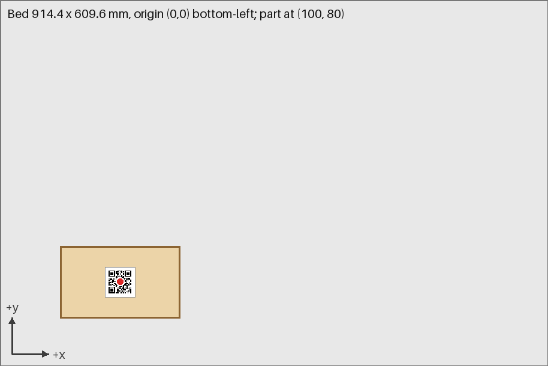

## Settings

All the settings, with the `.env` key and the command-line flag for each.

| `.env` key | CLI flag | Meaning |
|---|---|---|
| `CANVAS_WIDTH_MM`, `CANVAS_HEIGHT_MM` | `--canvas-width`, `--canvas-height` | Bed size. Default 914.4 × 609.6. |
| `PART_WIDTH_MM`, `PART_HEIGHT_MM` | `--part-width`, `--part-height` | Outer dimensions of the workpiece. |
| `PART_ANCHOR` | `--part-anchor` | Which bed corner the part is aligned to (same five choices as `ANCHOR`). Default `top-left`. |
| `PART_OFFSET_MM` | `--part-offset` | Shift `dx,dy` of the part from that corner. Up is +, so `10,-20` is 10 mm right and 20 mm down from the top-left. |
| `CODE_SIZE_MM` | `--code-size` | Box the code is shrunk into: `W,H`, or `S` for a square. The code stays square, so its side is `min(W, H)`. **`-1` makes it as large as the part allows.** |
| `ANCHOR` | `--anchor` | `top-left`, `top-right`, `bottom-left`, `bottom-right` or `center`. |
| `OFFSET_MM` | `--offset` | Shift `dx,dy` from the anchored position. Up is +. Blank or `0,0` means no shift. |
| `QR_BORDER` | `--border` | Quiet-zone width in modules (default 4). It's counted **inside** the code size. |
| `BLEED_PX` | `--bleed-px` | `x,y`: pixels (at `DPI`) to take off each edge of each dark module, separately across (X) and down (Y), to make up for the laser burning wider than drawn. One number applies to both. Default 0. Applies to both the PDF and the PNG. |
| `MERGE_X_RUNS` | `--merge-x`, `--no-merge-x` | Joins each row's run of adjacent dark modules into one rectangle, so the X bleed only applies at the run's two ends, where black meets white. Default `true`. |
| (none) | `--test-pattern` | Burns the [test pattern](#test-pattern) instead of a QR code. `TARGET_URL`, `QR_ERROR_CORRECTION` and `QR_BORDER` are ignored. |
| `QR_ERROR_CORRECTION` | `--ec` | `L`, `M`, `Q` or `H`. |
| `DPI` | `--dpi` | Output resolution. Default 300. |
| `TARGET_URL` | `--url` | The URL encoded in the code. |
| `OUTPUT_DIR` | `--out-dir` | Folder for output files, relative to the project. Default `output`. |
| `OUTPUT_PATH`, `PDF_PATH`, `PREVIEW_PATH` | `--out`, `--pdf`, `--preview` | File names inside the output folder. Leave `PDF_PATH` or `PREVIEW_PATH` blank to skip that file. |

The script stops with an error if the code would run off the bed. It warns if the code would run past the edge of the part.

## How to read the diagrams

- **Tan rectangle:** the part.
- **White square with a grey outline:** the code, quiet zone included. This is the square that `CODE_SIZE_MM` and the anchor apply to.
- **Red dot:** the anchor point on the part.
- **Blue dot and arrow:** where the offset moved that point.

In every diagram the part is 200 × 120 mm, placed as in the bed overview above.

## Anchors

The anchor names the corner of the code that lines up with the **same** corner of the part. For example, `top-left` puts the code's top-left corner on the part's top-left corner. `center` puts the code's centre on the part's centre.

| `top-left` | `top-right` |
|---|---|
|  | 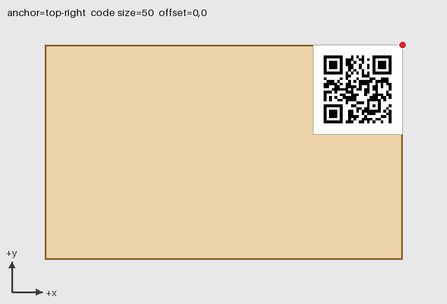 |
| **`bottom-left`** | **`bottom-right`** |
| 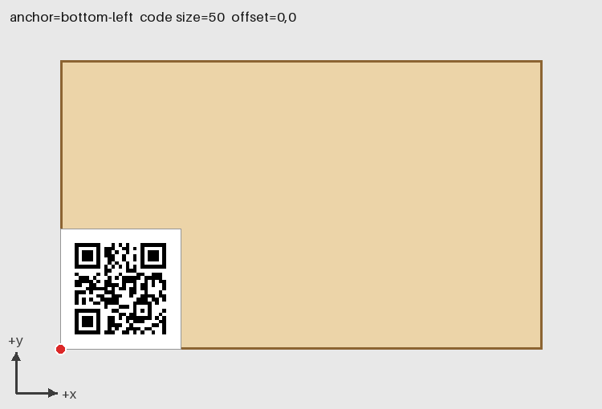 | 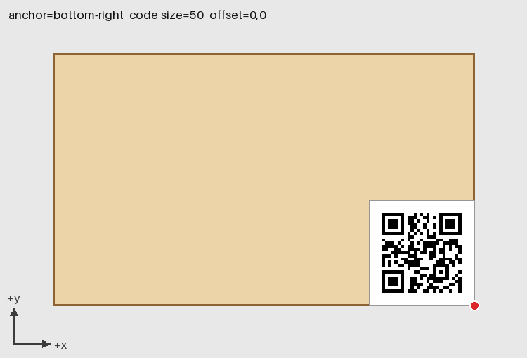 |

**`center`**

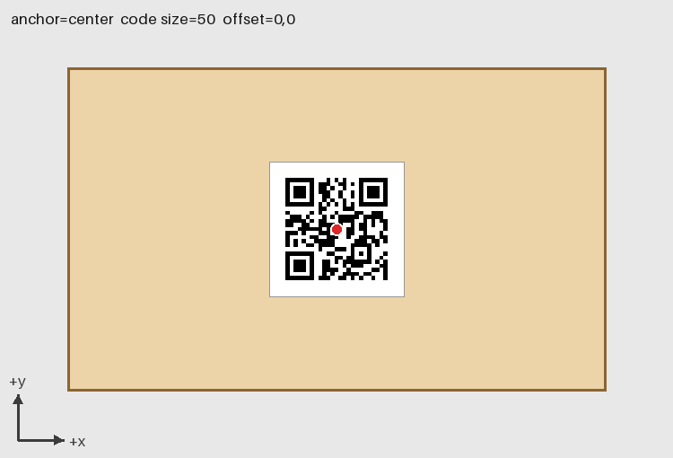

## Offsets

The offset moves the code after it's anchored. Positive `dx` moves it right, and positive `dy` moves it **up**.

**`top-left`, offset `20,-15`:** 20 mm right, 15 mm down, which is a typical inset from a corner.

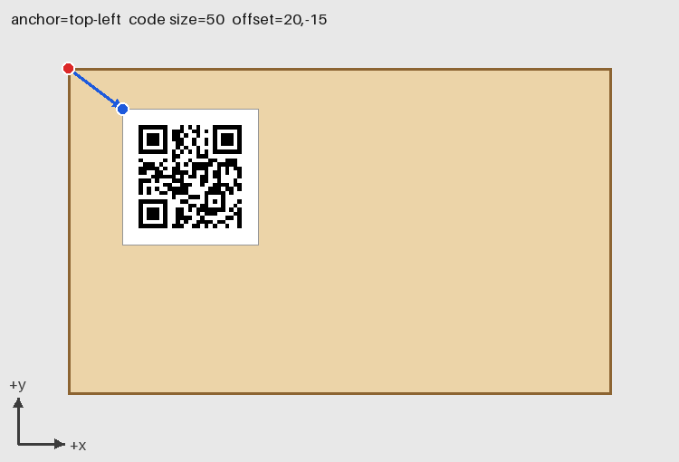

**`center`, offset `40,20`:** 40 mm right and 20 mm up from centre.

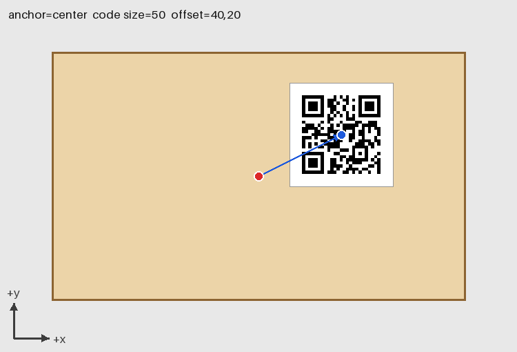

**`bottom-right`, offset `-10,10`:** 10 mm in from both the right and bottom edges.

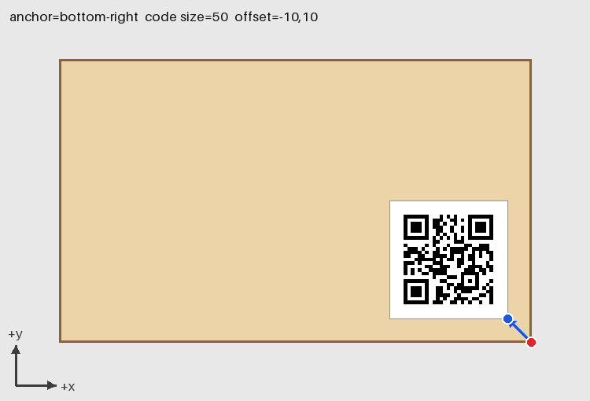

## Code size

**`-1` (as large as possible):** the code fills the part's shorter side, 120 mm here.

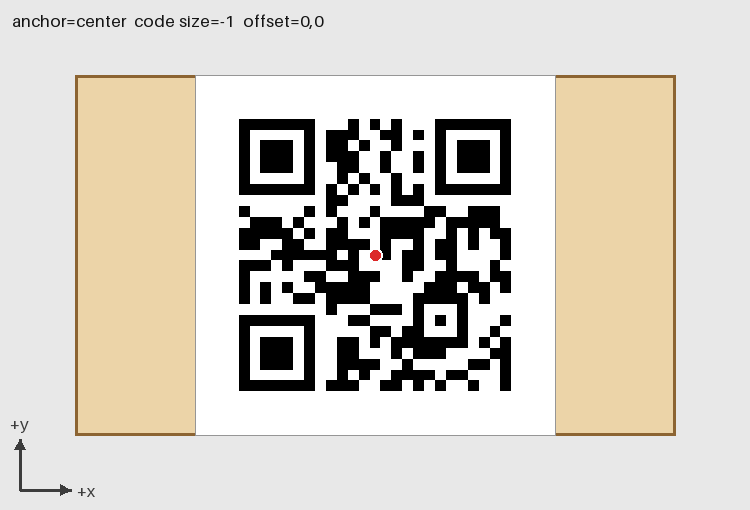

**`80,50` (bounding box):** the code shrinks to fit the box while staying square, so it's 50 × 50 mm. It's then anchored like any other size.

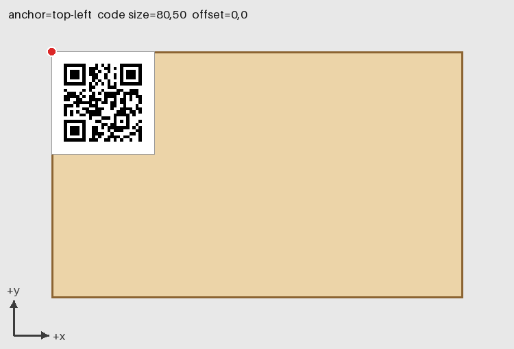

**`-1` with `QR_BORDER=0`:** the dark modules run right to the edges of the box. Only use this if the part itself leaves plain, light-coloured space around the code, because scanners need that quiet margin.

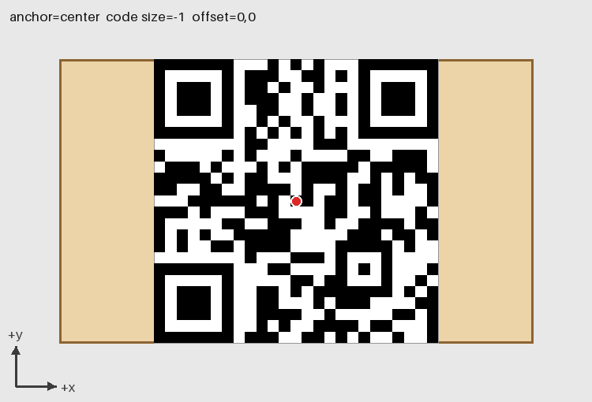

## Printing at actual size

Print **`output/laser-qr-code.pdf`**, not the PNG. Most apps ignore a PNG's DPI: Chrome and Edge treat it as 96 pixels per inch and shrink it to fit the page.

1. Open the PDF in Adobe Acrobat Reader, or in SumatraPDF (free).
2. Choose the laser as the printer and **Arch D** (36 × 24 in) **landscape** as the paper.
3. Set page sizing to **Actual size** (Acrobat) or **Use original page size** (SumatraPDF). Don't use "Fit" or "Shrink oversized pages".

To check the scale, do a test on scrap material and measure where the dark squares land. The script prints their exact position and size. If the whole job is shifted by a fixed amount, that comes from the printer driver's unprintable margin. Fix it in the laser driver's settings, or correct for it with `PART_OFFSET_MM`.

## Bleed compensation

If the white gaps come out narrower than the black squares, the laser is burning slightly past the edges of each module. Set `BLEED_PX` to move every edge of each dark module inwards, so the burn spreads back out to the full module size.

The value is `x,y`: the number of pixels to take off **each edge**, across (X) and down (Y). Pixels are at `DPI`, so at 300 DPI 1 px is 0.0847 mm. Each direction is set separately, because a raster laser usually bleeds mostly along X, its fast travel direction. `1,0` takes 1 px off the left and right edges and keeps the full height. A single number such as `1` applies to both directions.

**Why px, not %:** the laser overburns each edge by a fixed distance, set by its spot size and the material, however big the modules are. A fixed amount stays right when you change the code size. A % would need retuning. Whole numbers of pixels also keep the PNG's edges exact (see [Whole-pixel module sizes](#whole-pixel-module-sizes)). Fractions such as `0.5` work: the PDF uses the exact distance and the PNG rounds it.

**A positive value shrinks.** The setting can't enlarge modules, and it must leave something of each module: under half a module per edge.

**Merged X runs.** With `MERGE_X_RUNS=true` (the default), each row's run of adjacent dark modules is drawn as one rectangle. The X bleed is then taken only off the two ends of the run, where black meets white. Inside the run, where both neighbours are black, there's no bleed to correct, so no gaps are added. With `--no-merge-x`, every module is shrunk on its own, which leaves thin white gaps between black neighbours. Y bleed applies to every row either way.

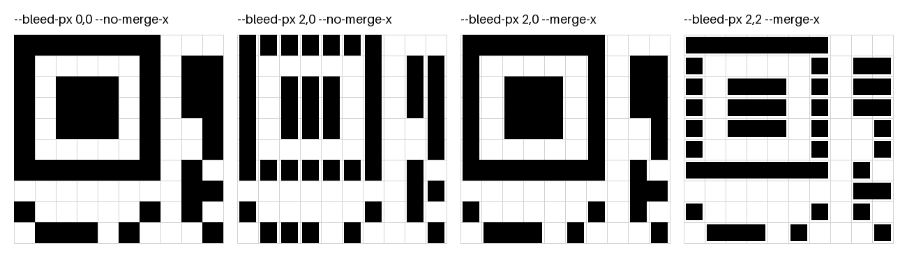

**Finding the values.** Measure one direction at a time on a test burn with no compensation. For X, measure across a black square (or stripe) and across the white gap beside it. For Y, measure the same things top to bottom. The laser makes black wider by its overburn on both edges, and white narrower by the same, so the overburn per edge for that direction is:

  **(black − white) ÷ 4**, in mm. Divide by the pixel size (0.0847 mm at 300 DPI) to get px.

**Example.** Your code has 1.524 mm (18 px) modules. Measured across (X), a black stripe is 1.70 mm and the white gap beside it is 1.35 mm. Measured top to bottom (Y), both are 1.52 mm.

1. X: (1.70 − 1.35) ÷ 4 = 0.0875 mm, ÷ 0.0847 ≈ **1 px**. Y: (1.52 − 1.52) ÷ 4 = **0 px**.
2. Run it:

   ```bash
   python place_qr.py --bleed-px 1,0
   ```

   The script prints:

   ```text
   Bleed X 1 px (0.085 mm), Y 0 px (0.000 mm) off each edge of each dark area
     X runs merged: each run of dark modules is 0.169 mm narrower than drawn and 1.524 mm tall, gaps 0.000 mm between rows
   ```

   The laser adds its extra 0.085 mm back on each end of each run, so black and white both come out at the full module width.
3. Burn another test. In each direction, if black still measures wider than white, increase that value. If white now measures wider, decrease it.

### Test pattern

A real QR code mixes every kind of edge together, which makes it hard to tell what's going wrong. `--test-pattern` burns a 38 × 38 module pattern instead, where each feature tests one thing:

| | Left | Middle | Right |
|---|---|---|---|
| **Top** (1-module features) | 1×1 checkerboard | 1×1 dots, 1-module gaps | Vertical stripes, 1 wide |
| **Middle** (2-module features) | 2×2 checkerboard | 2×2 dots, 2-module gaps | Vertical stripes, 2 wide |
| **Bottom** | Horizontal stripes, 1 wide | Horizontal stripes, 2 wide | QR finder square, which also shows which way up the burn is |

- **Stripes** are the ones to measure: vertical stripes give the black and white widths across (X), horizontal stripes top to bottom (Y). Use them in the formula above.
- **Checkerboards** show where black squares meet only at their corners. Bleed there fills in the corners first.
- **Dots** show how a lone dark module shrinks or swells, with no neighbours to merge with.
- The **finder** is a familiar reference from a real code.

The module size is `CODE_SIZE_MM` ÷ 38. To match your QR code, set `--code-size` to 38 × its module size (printed by a normal run): 1.17 mm modules need `--code-size 44.5`. Burn one pattern per bleed value, each with its own `--offset` and `--out`/`--pdf` names, and compare them side by side.

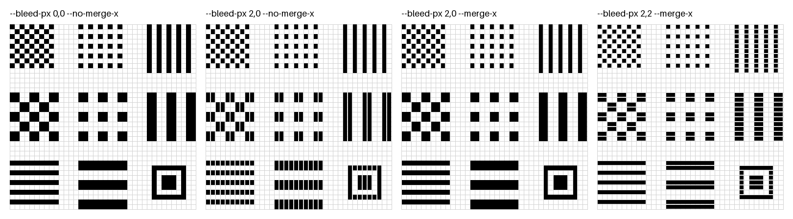

### Bleed test sheet

`make_bleed_sheet.py` puts four test patterns in a row on one full-bed file, one for each setting in the diagram above, in the same left-to-right order:

| # | Left edge | Setting |
|---|---|---|
| 1 | 0 mm | `--bleed-px 0,0 --no-merge-x` |
| 2 | 73.152 mm | `--bleed-px 2,0 --no-merge-x` |
| 3 | 146.304 mm | `--bleed-px 2,0 --merge-x` |
| 4 | 219.456 mm | `--bleed-px 2,2 --merge-x` |

```bash
python make_bleed_sheet.py
```

This writes `output/bleed-sheet.pdf` (print this one) and `output/bleed-sheet.png`. The modules are 18 px (1.524 mm), the same as a 50 mm QR code (see [Whole-pixel module sizes](#whole-pixel-module-sizes)), so each pattern is 57.912 mm square. There are 10 white modules (15.24 mm) between patterns. The row runs from the bed's left edge to x = 277.368 mm, and from 275.844 to 333.756 mm up from the bottom, which centres it on 12 in, halfway up the 24 in bed.

To compare powers and speeds, put a strip of material about 280 × 60 mm under the row and burn it. Then move the material so a fresh area is under the row, change the power or speed, and burn again. The PDF stays the same each time.

Options: `--module` (mm), `--left` (mm), `--center-y` (mm up from the bottom), `--gap` (modules), and `--out-dir`, `--out` and `--pdf` for the output names. Run `python make_bleed_sheet.py --help` for the full list.

### Whole-pixel module sizes

At 300 DPI a pixel is 25.4 ÷ 300 = 0.084667 mm. If the module size isn't a whole number of pixels, the PNG rounds each module edge, so modules come out a pixel wider or narrower than each other. For example, a 48 mm code with 41 modules has 13.83 px modules, which become a mix of 13 and 14 px.

To avoid this, use **18 px modules (exactly 1.524 mm, 0.06 in)**. These sizes give the QR code and the test pattern the same module size, so a test burn also shows how the final code's resolution will look:

| What | Modules | `--code-size` | Size of dark area |
|---|---|---|---|
| QR code, 33 modules plus a 4-module quiet zone on each side | 41 | `62.484` | 50.292 mm |
| Test pattern | 38 | `57.912` | 57.912 mm |

```bash
python place_qr.py --code-size 62.484
python place_qr.py --test-pattern --code-size 57.912 --bleed-px 1,0 --out bleed-1.png --pdf bleed-1.pdf
```

The QR code's module count depends on the URL and `QR_ERROR_CORRECTION`. A normal run prints the module size. If it isn't 1.52 mm, set `--code-size` to 1.524 × (modules across + 2 × `QR_BORDER`).

The PNG has no rounding only when all of these hold:

- **Position:** the code's corner lands on a pixel edge. The `top-left` anchor with no offset does. Any offset must be a whole number of pixels, such as a multiple of 1.524 mm (one module) or 25.4 mm (300 px).
- **Bleed:** `BLEED_PX` is a whole number.
- **What the laser receives:** this is only about the PNG. The PDF holds exact sizes, and the laser driver converts it to pixels at the laser's own resolution, so if you print the PDF, the module size should be a whole number of pixels at that resolution instead.

## Regenerating these diagrams

```bash
python make_examples.py
```
